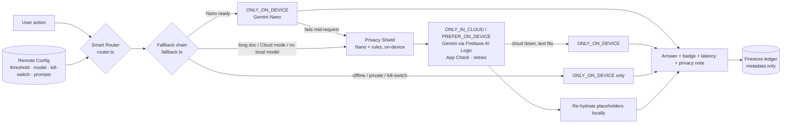

# Tandem Notes

**Your device thinks first. The cloud helps only when it should, and never sees what it doesn't need to.**

Tandem Notes is a private-first AI notebook for Chrome. It runs AI on **Gemini Nano on-device** when the browser has it, and uses **Gemini in the cloud** when it doesn't, or when a document is too long for the local model. Both go through the **Firebase AI Logic Hybrid Inference SDK**. Before any text can reach the cloud, an on-device **Privacy Shield** swaps names, emails, phone numbers and ID numbers for placeholders. When the answer comes back, the real values are put back in locally.

Built for **#BuildHybridAI** · Platform: **Web (Chrome)** · License: **Apache-2.0** · **Free to use**: no paywall, no account required (anonymous sign-in)

> **Live app:** `https://<your-project>.web.app` · **Demo video:** `https://youtu.be/<id>` *(fill in after deploying)*

---

## The problem, and why hybrid is the answer

Students write lecture notes on unreliable campus Wi-Fi. People keep journals, client calls and health details in their notes. Cloud AI is powerful but uploads every word and dies when the Wi-Fi does. On-device AI is private, free and works offline, but it isn't on every device and has a small context window (about 9k tokens for Gemini Nano).

Tandem Notes uses both, and **shows you which one answered, how fast, and what (if anything) left your device**:

| Situation | Where it runs |
|---|---|
| Short note, Gemini Nano ready | **On-device**. If Nano fails partway, it retries in the cloud *with redaction* |
| Long document (over the Remote Config `on_device_max_chars`) | **Cloud**, redacted first. If the cloud fails, falls back to Nano when the text fits |
| Browser without a local model | **Cloud**, through the SDK's `PREFER_ON_DEVICE` fallback, redacted first |
| Offline / airplane mode | **On-device only**. Notes keep saving and sync later |
| Device-only (private) note | **On-device only, always**. Never synced, never sent to the cloud |
| Cloud paused by the admin (Remote Config kill-switch) | **On-device only** |

## Standout features

1. **Visible hybrid routing.** Before you click, the AI panel shows the plan (e.g. *Gemini Nano → Cloud fallback (shielded)*) and the `InferenceMode`. After you click, each answer shows an **On-device / Cloud** badge (from the SDK's `inferenceSource`), the latency, a one-line privacy note, and any fallback or retry that happened.
2. **Privacy Shield + "What left my device".** On-device redaction before any cloud attempt, local re-hydration afterwards, and the exact prompt the cloud received, so the privacy claim can be checked rather than taken on trust.
3. **Works in airplane mode.** An offline demo toggle (click **Online** in the header) or real airplane mode. The service-worker shell, Firestore offline cache and Gemini Nano keep everything usable.

Plus: Summarize (streaming), Action items and Title & tags (structured JSON output on both paths), Rewrite in a chosen tone, Ask-the-note Q&A, **Compare** on-device vs cloud side by side, an **Insights** panel (on-device share, latency for each side, redactions, routing log), first-run onboarding, a one-click Gemini Nano download with progress, and selection-aware processing.

---

## Where Firebase AI Logic is imported and called

All AI goes through the Firebase AI Logic Web SDK (`firebase/ai`), imported and called at runtime:

| What | File:line |
|---|---|
| `import { getAI, GoogleAIBackend } from 'firebase/ai'` | [src/firebase.ts:27](src/firebase.ts#L27) |
| `initializeAppCheck(...)`: required by AI Logic | [src/firebase.ts:119](src/firebase.ts#L119) |
| `getAI(app, { backend: new GoogleAIBackend(), useLimitedUseAppCheckTokens: true })` | [src/firebase.ts:146](src/firebase.ts#L146) |
| `getGenerativeModel(ai, { mode, onDeviceParams, inCloudParams })` | [src/ai/engine.ts:90](src/ai/engine.ts#L90), params built at [src/ai/engine.ts:99-107](src/ai/engine.ts#L99-L107) |
| Structured output: on-device `responseConstraint` + cloud `responseJsonSchema` | [src/ai/engine.ts:101-105](src/ai/engine.ts#L101-L105) |
| `generateContent()` for JSON tasks + `response.inferenceSource` | [src/ai/engine.ts:236-238](src/ai/engine.ts#L236-L238) |
| `generateContentStream()` + per-chunk `inferenceSource` | [src/ai/engine.ts:245-259](src/ai/engine.ts#L245-L259) |
| Privacy Shield entity scan forced `ONLY_ON_DEVICE` (refuses if it didn't run on-device) | [src/ai/engine.ts:126-127](src/ai/engine.ts#L126-L127) |
| `initializeDeviceModel(onProgress)`: Gemini Nano download from a click | [src/ai/device.ts:50](src/ai/device.ts#L50) |
| Routing policy → `InferenceMode` | [src/ai/router.ts:42](src/ai/router.ts#L42) |
| Fallback chain (Nano → shielded cloud, cloud → Nano) | [src/ai/fallback.ts:49](src/ai/fallback.ts#L49) |
| Attempt loop, shield-once, retries, discarding partial output | [src/ai/engine.ts:152-220](src/ai/engine.ts#L152-L220) |

**Why not rely on `PREFER_ON_DEVICE` alone?** We read the SDK source. It only falls back to the cloud when Nano is *unavailable*. If the on-device call itself throws, the error reaches the user. And when it does fall back on its own, the Privacy Shield hasn't run. So when Nano is ready we run `ONLY_ON_DEVICE` first and make the cloud an explicit, *redacted* second attempt. When Nano isn't ready we still hand off to `PREFER_ON_DEVICE` (it re-checks availability itself), redacting first. The full reasoning is in [src/ai/fallback.ts](src/ai/fallback.ts).

**Gemini Nano does not receive `systemInstruction`.** The Chrome adapter forwards only message contents, so every task builds one self-contained prompt ([src/ai/tasks.ts](src/ai/tasks.ts)) and behaves the same on both paths.

## Firebase products, each with a job

| Product | Purpose | Where |
|---|---|---|
| **App Check** (required) | Protects the Gemini API: reCAPTCHA Enterprise in production, debug token for development. **Limited-use tokens** for replay protection | [src/firebase.ts:93-119](src/firebase.ts#L93-L119) |
| **Remote Config** | Change behaviour without redeploying: `cloud_enabled` (**kill-switch**), `on_device_max_chars` (routing threshold), `cloud_model` (model selection), `prompt_templates` (**prompt templates**), `privacy_shield_enabled`, `shield_max_chunks`, `default_routing`, `announcement` | [remoteconfig.template.json](remoteconfig.template.json), [src/firebase.ts:161-173](src/firebase.ts#L161-L173) |
| **Authentication** | Instant anonymous sign-in, upgradeable to Google with `linkWithPopup` (same uid, so notes follow you to other devices) | [src/data/auth.ts](src/data/auth.ts) |
| **Cloud Firestore** | Notes sync (persistent offline cache), synced settings, and an inference ledger that stores **metadata only**. Device-only notes are never written here | [src/data/notes.ts](src/data/notes.ts), [src/data/settings.ts](src/data/settings.ts), [src/data/ledger.ts](src/data/ledger.ts), [firestore.rules](firestore.rules) |
| **Hosting** | Serves the offline-capable PWA | [firebase.json](firebase.json) |

## Architecture



---

## Run it

### Prerequisites
- Node.js 20+
- A Firebase project. The Gemini Developer API free tier works on the no-cost plan.
- **Chrome 139+ on desktop** (Windows, macOS, Linux, ChromeOS) for on-device inference. Any other browser, including mobile, still works through the cloud fallback.

### 1. Firebase console (about 10 minutes)
1. Create a project at <https://console.firebase.google.com>.
2. **AI Logic** → *Get started* → **Gemini Developer API**.
3. **Project settings → Your apps → Web app**: copy the config.
4. **Authentication → Sign-in method**: enable **Anonymous** and **Google**.
5. **Firestore Database**: create it in production mode. The rules are deployed below.
6. **App Check → Apps**: register the web app with **reCAPTCHA Enterprise** (recommended) or **reCAPTCHA v3**, using a key that allows your hosting domain (`<project>.web.app`). Put the site key in `VITE_RECAPTCHA_ENTERPRISE_SITE_KEY` or `VITE_RECAPTCHA_V3_SITE_KEY`. Then **App Check → APIs → Firebase AI Logic → Enforce**. *(AI Logic enforcement became automatic in November 2026.)*

### 2. Configure and run locally

```bash
git clone https://github.com/shravyasaravanane/HybridAI.git && cd HybridAI
npm install
cp .env.example .env.local    # fill in the Firebase config values
npm run dev                   # http://localhost:5173
```

### 3. App Check debug token (local development and judging)
1. Keep `VITE_APPCHECK_DEBUG_TOKEN=true` in `.env.local` and open the app.
2. DevTools console prints `Firebase App Check debug token: <uuid>`.
3. Firebase console → **App Check → Apps → ⋮ → Manage debug tokens → Add**, and paste it.
4. Put that same uuid in `VITE_APPCHECK_DEBUG_TOKEN` so it stays stable across browsers.
5. Never commit it. `.env*` is git-ignored. The debug token is only used by `npm run dev`; production builds ignore it unless you set `VITE_APPCHECK_DEBUG_IN_PROD=true` (judging-only, revoke afterwards).

### 4. Enable Gemini Nano in Chrome
1. Open `chrome://flags/#prompt-api-for-gemini-nano-multimodal-input`, set it to **Enabled**, and restart Chrome.
2. In the app, click **Get Gemini Nano** (header or onboarding). A progress bar shows the download.
3. Check in DevTools: `await LanguageModel.availability()` returns `"available"`.

### 5. Test and deploy

```bash
npm test             # 41 unit tests: routing, fallback chain, retries, engine fallback, Privacy Shield, prompts
npm run build        # type-check + production build
npm run preview      # production build locally (service worker on: try real airplane mode)

npm i -g firebase-tools && firebase login
cp .firebaserc.example .firebaserc        # set your project id
# production uses the reCAPTCHA key from .env.local; the debug token is ignored in builds
npm run deploy       # hosting + firestore.rules + remoteconfig.template.json
```

Optional no-cost local backend: `npx firebase-tools emulators:start --project demo-tandem` with `VITE_USE_EMULATORS=true` runs Auth and Firestore locally. AI Logic always uses the real backend.

### Platforms
| Platform | Status |
|---|---|
| **Web: Chrome desktop 139+** | Full hybrid: Gemini Nano on-device + cloud fallback |
| Web: other browsers / mobile Chrome | Cloud path (the SDK's automatic fallback), Privacy Shield pattern rules |
| Android / iOS | Not built yet. See *Extending to Android and iOS* |

---

## Judge's 2-minute tour
1. Open the app. Onboarding explains on-device vs cloud. Click **Start writing**. Four demo notes appear (anonymous sign-in).
2. Open **Lecture 7: CPU scheduling** → **Summarize**. Look for the blue **On-device** badge, the latency, and *Privacy: processed on this device*.
3. Open **Client call: Priya Sharma**, switch to **Cloud** → **Summarize** → expand **What left my device**. The cloud saw only `[PERSON_1]`, `[EMAIL_1]` and so on, while you see the real names.
4. Press **Compare on-device vs cloud** for side-by-side latency.
5. Click **Online** in the header to start the offline demo, then run **Action items**. Gemini Nano answers and edits show "Saved offline · will sync".
6. Open **Insights** for the on-device share, latency for each side, redactions, and the routing log.
7. Remote Config: set `on_device_max_chars` = `300` (that note now routes to the cloud as a long doc) or `cloud_enabled` = `false` (a banner appears and everything runs on-device). Reload with `?rcfresh` to fetch immediately; otherwise clients pick up changes within 5 minutes.

## Latency comparison
Insights and **Compare** record real on-device vs cloud latency on your machine. Fill this table from your own run before submitting. We don't publish numbers we haven't measured.

| Task (≈1k-char note) | On-device (Gemini Nano) | Cloud (`gemini-3.5-flash-lite`) |
|---|---|---|
| Summarize | _ms_ | _ms_ |
| Action items (JSON) | _ms_ | _ms_ |

## Extending to Android and iOS
The policy and prompt layer is pure TypeScript with no browser or Firebase dependencies, so it ports directly:
- [src/ai/router.ts](src/ai/router.ts) (routing policy), [src/ai/fallback.ts](src/ai/fallback.ts) (attempt chain and retry rules), [src/ai/privacy.ts](src/ai/privacy.ts) (redaction and re-hydration), [src/ai/tasks.ts](src/ai/tasks.ts) (prompts and JSON schemas). Their unit tests ([tests/](tests)) double as the cross-platform spec.
- The backend contract is shared: the same Firestore schema and rules, the same Remote Config parameters (one kill-switch and one set of prompt templates for every client), and the same App Check enforcement.
- A Kotlin client would map this to Firebase AI Logic's Android hybrid inference with Gemini Nano, and a Swift client to its iOS support for Apple Foundation Models. Check the current Firebase AI Logic docs for the exact per-platform API names.

## Project structure
```
src/
  firebase.ts        App, App Check, Auth, Firestore, Remote Config, AI Logic
  main.ts            UI (vanilla TypeScript)
  ai/router.ts       routing policy → InferenceMode          (pure, tested)
  ai/fallback.ts     attempt chain + retry/backoff            (pure, tested)
  ai/engine.ts       Firebase AI Logic calls, streaming, JSON, fallback loop (tested with fake models)
  ai/privacy.ts      Privacy Shield                           (pure, tested)
  ai/tasks.ts        prompts, JSON schemas, Remote Config templates (tested)
  ai/device.ts       Gemini Nano availability + download
  data/              notes (Firestore + device-only), settings, ledger, auth
  ui/                DOM helpers, onboarding
public/sw.js         offline shell (precaches the build at install)
firestore.rules      owner-only access + field validation
remoteconfig.template.json
tests/               Vitest
```

## Privacy and security
- Device-only notes live in `localStorage` for the signed-in uid and are never sent to Firestore or the cloud model. The router has no code path that sends them to the cloud (tested).
- The ledger stores metadata only: task, source, mode, reason, latency, size and redaction count.
- Firestore rules: users can only touch `users/{their uid}/**`, with field validation.
- No keys in the repo. `.env*` is git-ignored and `.env.example` documents every variable.
- The Privacy Shield is best-effort risk reduction, not a compliance guarantee. Name and address detection needs Gemini Nano; pattern rules cover emails, phone numbers, cards, IDs and IP addresses.

## Built with
Firebase AI Logic (hybrid inference: Gemini Nano + Gemini Developer API) · App Check · Authentication · Cloud Firestore · Remote Config · Hosting · Chrome built-in AI (Prompt API) · TypeScript · Vite · Vitest

## License
[Apache License 2.0](LICENSE). Free and open source.
## Performance: on-device vs cloud

| Path | Runs | Median | Range | Mean |
|---|---|---|---|---|
| On-device (Gemini Nano) | 7 | **14.1 s** | 12.4 to 15.1 s | 13.9 s |
| Cloud (gemini-3.5-flash-lite) | 7 | **21.8 s** | 16.8 to 24.4 s | 21.7 s |

On-device was about 1.5x faster at the median and more consistent.

Measured on [laptop model, CPU, RAM, GPU], Chrome [version], same note, online,
n=7 paired runs. The cloud path includes the on-device Privacy Shield pass that
redacts sensitive details before upload, so cloud time = redaction + network +
model. Results will vary by hardware and network.

## Privacy results

- 9 requests ran fully on-device, so 8,757 characters never left the device.
- The Privacy Shield redacted 6 items before cloud calls.
- Device-only notes are never synced to Firestore.