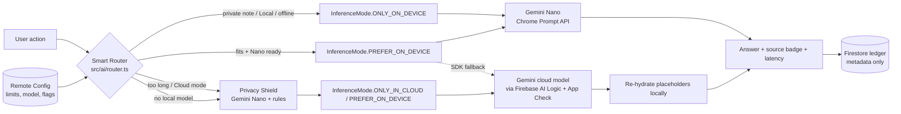

# Tandem Notes

**Your device thinks first. The cloud helps only when it should, and never sees what it doesn't need to.**

Tandem Notes is a private-first AI notebook for Chrome. It uses **Firebase AI Logic hybrid inference**: AI runs on **Gemini Nano on-device** when the browser has it, and falls back to **Gemini in the cloud** when it doesn't, or when a document is too long for the local model. Before any text can reach the cloud, an on-device **Privacy Shield** swaps names, emails, phone numbers, addresses and ID numbers for placeholders. When the answer comes back, the real values are put back in locally.

Built for the **#BuildHybridAI** challenge · Platform: **Web (Chrome)** · License: **Apache-2.0**

> Live demo: `https://<your-project>.web.app` · Demo video: `https://youtu.be/<id>` *(fill in after deploying)*

---

## Why it matters (value proposition)

Notes are some of the most personal data people keep: client calls, journals, health and money. Today you have to pick one:

| Cloud-only AI | On-device-only AI |
|---|---|
| Powerful, long context | Private, free, works offline |
| Every word is uploaded | Not on every device; small context window |

Tandem Notes doesn't make you pick. For every request, a **Smart Router** chooses the right place to run, and the app **shows you where it ran and why**:

- **Short notes → Gemini Nano on-device.** Instant, free, private, and works offline.
- **Long documents → cloud Gemini.** The over-budget threshold is set in Remote Config.
- **No on-device model in this browser → automatic cloud fallback** through the SDK (`PREFER_ON_DEVICE`).
- **Anything going to the cloud → Privacy Shield first.** Gemini Nano plus deterministic rules redact personal data locally, and the cloud only ever sees `[PERSON_1]`, `[EMAIL_1]` and so on.
- **Device-only notes** are never synced and only ever use `ONLY_ON_DEVICE`, even if you pick Cloud mode.
- **Offline** → automatically `ONLY_ON_DEVICE`. Notes keep syncing later through Firestore's offline cache.

The result is cloud-quality AI on long documents, with on-device privacy and cost for everything else. You can check it yourself in the "What left my device" panel.

## Features

| | Feature | Where it runs |
|---|---|---|
| ✍️ | **Summarize** (streaming bullets) | hybrid |
| ✅ | **Action items** as a checklist, via **structured JSON output** (same JSON Schema on-device and in-cloud) | hybrid |
| 🏷️ | **Auto title & tags** (structured output), applied with one click | hybrid |
| 🔁 | **Rewrite** in a tone (clearer / concise / formal / friendly), with undo | hybrid |
| ❓ | **Ask the note**: grounded Q&A | hybrid |
| ⚖️ | **Compare**: runs the same prompt with `ONLY_ON_DEVICE` and `ONLY_IN_CLOUD` side by side and shows latency for each | both |
| 🛡️ | **Privacy Shield**: on-device redaction → cloud → local re-hydration, with a full "What left my device" view | on-device |
| 🔒 | **Device-only notes**: kept in the browser, never in Firestore, AI only on Gemini Nano | on-device |
| 🧭 | **Live routing preview**: shows the `InferenceMode` the next request will use and why | – |
| 📊 | **Insights**: on-device vs cloud share, latency, redactions, and a full routing log | – |
| ⬇️ | **One-click Gemini Nano download** with a progress bar (`initializeDeviceModel`) | – |
| ✂️ | **Selection-aware**: select a passage in a long doc to process just that (and keep it on-device) | – |
| 📶 | **Offline-ready PWA**: service worker + Firestore persistent cache | – |

## How Firebase AI Logic is used

All AI goes through the Firebase AI Logic Web SDK (`firebase/ai`). The calls happen at runtime in these files:

| What | Where |
|---|---|
| `getAI(app, { backend: new GoogleAIBackend(), useLimitedUseAppCheckTokens: true })` | [src/firebase.ts](src/firebase.ts) |
| `getGenerativeModel(ai, { mode, onDeviceParams, inCloudParams })`: hybrid models per `InferenceMode` | [src/ai/engine.ts](src/ai/engine.ts) |
| `generateContentStream()` for streaming; reads `chunk.inferenceSource` / `response.inferenceSource` (`on_device` / `in_cloud`) | [src/ai/engine.ts](src/ai/engine.ts) |
| Structured output: `onDeviceParams.promptOptions.responseConstraint` + `inCloudParams.generationConfig.responseJsonSchema` | [src/ai/engine.ts](src/ai/engine.ts), [src/ai/tasks.ts](src/ai/tasks.ts) |
| `ONLY_ON_DEVICE` Gemini Nano entity extraction for the Privacy Shield (refuses to continue if it didn't run on-device) | [src/ai/engine.ts](src/ai/engine.ts) `detectEntitiesOnDevice` |
| `model.initializeDeviceModel(onProgress)`: model download from a user gesture | [src/ai/device.ts](src/ai/device.ts) |
| Choosing `PREFER_ON_DEVICE` / `ONLY_ON_DEVICE` / `ONLY_IN_CLOUD` per request | [src/ai/router.ts](src/ai/router.ts) |

The on-device Chrome adapter passes only message contents to Gemini Nano, not `systemInstruction`. Because of that, every task builds one self-contained prompt, so the same prompt behaves the same way on-device and in the cloud.

### Other Firebase products

| Product | Use |
|---|---|
| **App Check** (required) | reCAPTCHA Enterprise in production; **debug token** for local runs and judging. **Limited-use tokens** for replay protection on AI calls. [src/firebase.ts](src/firebase.ts) |
| **Authentication** | Instant **anonymous** sign-in (no sign-up wall), upgradeable to **Google** via `linkWithPopup`, so notes keep the same uid. [src/data/auth.ts](src/data/auth.ts) |
| **Cloud Firestore** | Notes sync with **persistent offline cache**, plus the **inference ledger** (metadata only, never note text). Locked down by [firestore.rules](firestore.rules). [src/data/notes.ts](src/data/notes.ts), [src/data/ledger.ts](src/data/ledger.ts) |
| **Remote Config** | Tune routing without redeploying: `cloud_model`, `on_device_max_chars`, `privacy_shield_enabled`, `shield_max_chunks`, `default_routing`, `announcement`. [remoteconfig.template.json](remoteconfig.template.json) |
| **Hosting** | Static hosting of the PWA. [firebase.json](firebase.json) |

## Architecture



**Routing rules** (pure function, unit-tested in [tests/router.test.ts](tests/router.test.ts)):

| Situation | InferenceMode | Shield |
|---|---|---|
| Device-only note | `ONLY_ON_DEVICE` (blocked with a clear message if Nano is missing or the text is over budget) | n/a |
| Local mode, or offline | `ONLY_ON_DEVICE` | n/a |
| Cloud mode | `ONLY_IN_CLOUD` | ✅ |
| Auto, text > `on_device_max_chars` | `ONLY_IN_CLOUD` | ✅ |
| Auto, fits, Nano ready | `PREFER_ON_DEVICE` | – |
| Auto, Nano not available / still downloading | `PREFER_ON_DEVICE` → SDK cloud fallback | ✅ |

**Privacy Shield** ([src/ai/privacy.ts](src/ai/privacy.ts), tested in [tests/privacy.test.ts](tests/privacy.test.ts)):
1. Deterministic rules: emails, phone numbers, Luhn-validated card numbers, SSN and 12-digit national ID formats, IP addresses.
2. Gemini Nano (`ONLY_ON_DEVICE`, JSON-constrained) adds names, addresses, private places and organisations. Results are only kept if they literally appear in the text, which guards against hallucinated entities.
3. Every occurrence is replaced with a stable placeholder, and the cloud prompt tells the model to keep placeholders as they are.
4. Streamed and structured cloud output is re-hydrated on-device.

---

## Run it yourself

### Prerequisites
- Node.js 20+ and npm
- A Firebase project (Blaze is **not** required for the Gemini Developer API free tier)
- **Chrome 139+ on desktop** for on-device inference (see below). Other browsers still work through the cloud fallback.

### 1. Firebase console setup (about 10 minutes)
1. **Create a project** at <https://console.firebase.google.com>.
2. **AI Logic**: open *AI Services → AI Logic → Get started* and choose the **Gemini Developer API**.
3. **Register a Web app**: *Project settings → General → Your apps → Web*. Copy the config values.
4. **Authentication**: *Build → Authentication → Sign-in method*. Enable **Anonymous** and **Google**.
5. **Firestore**: *Build → Firestore Database → Create database* (production mode). The rules are deployed in step 4 below.
6. **App Check**: *Security → App Check → Apps*. Register the web app with **reCAPTCHA Enterprise** (create a key for your hosting domain). For local use, add a **debug token** (see the next step).
7. **Remote Config** is optional: the defaults are built in. Deploy the template in step 4 to manage values from the console.

### 2. Configure

```bash
git clone <this repo> && cd tandem-notes
npm install
cp .env.example .env.local      # then fill in the values
```

App Check for local development: keep `VITE_APPCHECK_DEBUG_TOKEN=true` and run the app. Open DevTools; the console prints `Firebase App Check debug token: …`. Add it in *Security → App Check → Apps → ⋮ → Manage debug tokens*, then paste that same token string into `VITE_APPCHECK_DEBUG_TOKEN` so it stays stable.

### 3. Run

```bash
npm run dev        # http://localhost:5173
npm test           # unit tests (router, Privacy Shield, prompts)
npm run build      # type-check + production build
```

Optional local backend: `npx firebase-tools emulators:start --project demo-tandem` with `VITE_USE_EMULATORS=true` runs Auth and Firestore locally. AI Logic always uses the real backend.

### 4. Deploy (Firebase Hosting)

```bash
npm i -g firebase-tools
firebase login
cp .firebaserc.example .firebaserc   # set your project id
# Production App Check: put VITE_RECAPTCHA_ENTERPRISE_SITE_KEY in .env.production.local
# and leave VITE_APPCHECK_DEBUG_TOKEN empty there.
npm run deploy                       # builds, then deploys hosting + firestore rules + remote config
```

> **Hosted judging tip:** reCAPTCHA Enterprise is the right production setup. If you instead want the hosted build to use a debug token during judging, set a dedicated, registered debug token in `.env.production.local`, and revoke it in the console after judging. Anyone who has the site can use that token.

### Enable Gemini Nano in Chrome
1. Use **Chrome 139 or newer** on desktop (Windows, macOS, Linux or ChromeOS) with enough free disk space for the model.
2. Open `chrome://flags/#prompt-api-for-gemini-nano-multimodal-input`, set it to **Enabled**, and restart Chrome.
3. In Tandem Notes, click **Get Gemini Nano** in the header. The download starts from that click and shows a progress bar. You can check it in DevTools with `await LanguageModel.availability()`.

If the model isn't available, the header shows **No on-device model** and everything still works through the cloud. That path is the hybrid fallback.

---

## Judge's 2-minute tour
1. Open the app. You are signed in anonymously and three demo notes are created.
2. Open **Welcome to Tandem Notes** and press **Summarize**. The result card shows **On-device** (blue) or **Cloud** (orange), the latency, and the `InferenceMode` used.
3. Open **Client call: Priya Sharma**, switch routing to **Cloud** and press **Summarize**. Read the *Privacy Shield redacted N items* line, then open **What left my device** to see the exact prompt with `[PERSON_1]`, `[EMAIL_1]`, `[PHONE_1]` and so on. The answer on screen still shows the real names.
4. Press **Compare on-device vs cloud** to race Gemini Nano against the cloud model.
5. Open the **device-only journal** and run **Action items**. It is forced on-device, and in Cloud mode it is blocked from going to the cloud.
6. Turn off Wi-Fi. The header shows **Offline**, routing switches to `ONLY_ON_DEVICE`, and notes keep saving.
7. Open **Insights** for the on-device share, latencies, redactions and the full routing log.
8. In Remote Config, set `on_device_max_chars` to `500` and reload. The same note now routes to the cloud as a "long document".

## Project structure

```
src/
  firebase.ts        Firebase App, App Check, Auth, Firestore, Remote Config, AI Logic
  main.ts            UI (vanilla TypeScript, no framework)
  ai/router.ts       Smart Router → InferenceMode per request (pure, tested)
  ai/engine.ts       Firebase AI Logic calls: streaming, structured output, inferenceSource
  ai/privacy.ts      Privacy Shield: detection, redaction, re-hydration (pure, tested)
  ai/tasks.ts        Prompts + JSON Schemas for each AI action
  ai/device.ts       Gemini Nano availability + download
  data/notes.ts      Firestore notes (offline cache) + device-only local notes
  data/ledger.ts     Inference ledger + stats
  data/auth.ts       Anonymous → Google account linking
public/sw.js         Offline app shell
firestore.rules      Owner-only access, schema validation
remoteconfig.template.json
tests/               Vitest unit tests
```

## Privacy & security notes
- Device-only notes are stored in `localStorage` for the signed-in uid and are never sent to Firestore or the cloud model.
- The Firestore ledger stores only metadata: task, source, mode, reason, latency, character count and redaction count.
- Firestore rules only allow a user to read and write `users/{their uid}/**`, with field validation.
- App Check (with limited-use tokens) protects the Gemini API from abuse. The repository never contains keys: `.env*` files are git-ignored.
- The Privacy Shield reduces risk but is best-effort, not a compliance guarantee. Its pattern rules focus on common formats, and model-based detection depends on Gemini Nano being available.

## Built with
Firebase AI Logic (hybrid inference, Gemini Nano + Gemini Developer API) · Firebase App Check · Firebase Authentication · Cloud Firestore · Firebase Remote Config · Firebase Hosting · Chrome built-in AI (Prompt API) · TypeScript · Vite · Vitest

## License
[Apache License 2.0](LICENSE)
