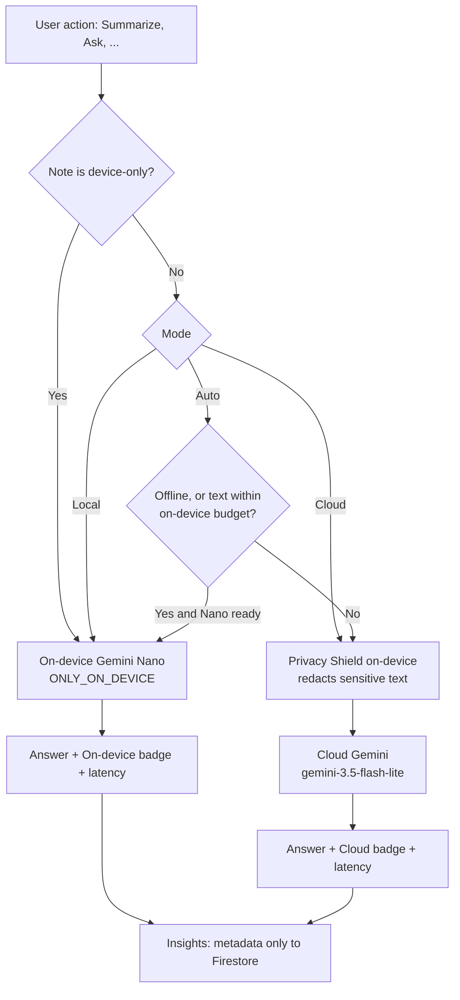

# Tandem Notes

**On-device first, cloud when it counts.**
A notes app that runs AI on your device with Gemini Nano when it can, and falls back to the cloud only when it needs to. Built with Firebase AI Logic Hybrid Inference for #BuildHybridAI.

- **Live app:** [YOUR_HOSTING_URL, e.g. https://hybridai-bfc6d.web.app]
- **Demo video (3 min):** [YOUR_YOUTUBE_LINK]
- **License:** Apache-2.0

> Open the live app in desktop **Chrome** (see "Enable Gemini Nano" below). Without Gemini Nano the app still works, using the cloud path.

---

## The problem

Note apps with AI send your private notes to a server, and they stop working when you are offline. On-device models are private, free and work offline, but they are not on every device. Tandem Notes uses both.

## What it does

| Feature | What it does |
|---|---|
| **Summarize** | 3 to 5 bullet TL;DR of a note |
| **Action items** | Extracts to-dos as a checklist |
| **Title & tags** | Auto-titles a note and suggests 3 to 5 tags |
| **Rewrite** | Polishes a note in a chosen tone |
| **Ask** | Ask a question about the open note |
| **Compare on-device vs cloud** | Runs the same task on both paths and shows timings |
| **Insights** | Shows where each request ran, why, how long it took, and how much text never left the device |
| **Device-only notes** | Private notes that never sync to Firestore. AI on them always runs on Gemini Nano |
| **Privacy Shield** | Redacts sensitive details on-device before any text goes to the cloud |
| **Routing modes** | Auto, Local or Cloud, chosen by the user |

Every answer shows a badge (**On-device** or **Cloud**), the latency, and what, if anything, left the device.

## How hybrid routing works



**Routing policy**

1. Device-only notes always run on-device and can never be sent to the cloud.
2. Offline requests run on-device.
3. Short notes (within the on-device budget of [12,000] characters, set in Remote Config) run on-device.
4. Long or complex requests go to the cloud, after the Privacy Shield redacts sensitive details.
5. If Gemini Nano is unavailable or fails, the request falls back to the cloud (unless the note is device-only).

Edge states handled: model not downloaded, downloading (with progress), unavailable, network failure, and mid-request fallback.

## How Firebase AI Logic is used

- **Hybrid Inference SDK** (`firebase/ai`) runs prompts on-device when Gemini Nano is available and in the cloud otherwise. Modes used: `InferenceMode.ONLY_ON_DEVICE` for local and device-only notes, and the cloud/prefer-on-device modes for Auto and Cloud. [CHECK this against your code and list the exact modes you use.]
- **Where it is imported and called:**
  - Initialization: `[src/firebase.js, line X]` (`getAI`)
  - Model creation: `[src/ai/..., line X]` (`getGenerativeModel` with the hybrid mode)
  - Calls: `[src/ai/..., line X]` (`generateContent` / `generateContentStream`)
- **Cloud model:** `gemini-3.5-flash-lite` through the Gemini Developer API.

## Other Firebase products

| Product | Purpose |
|---|---|
| **App Check** | Protects AI Logic and Firestore from abuse. Debug tokens for local development |
| **Remote Config** | Controls the on-device character budget, Privacy Shield on/off, cloud model and prompts, without redeploying |
| **Authentication** | [Google sign-in / anonymous] so notes and settings follow the user |
| **Firestore** | Syncs notes and stores Insights as metadata only (never note text). Device-only notes are never written. Security rules are in `firestore.rules` |
| **Hosting** | Serves the live app |

## Performance: on-device vs cloud

| Path | Runs | Median | Range | Mean |
|---|---|---|---|---|
| On-device (Gemini Nano) | 7 | **14.1 s** | 12.4 to 15.1 s | 13.9 s |
| Cloud (gemini-3.5-flash-lite) | 7 | **21.8 s** | 16.8 to 24.4 s | 21.7 s |

On-device was about 1.5x faster at the median and more consistent.

Measured on an HP OmniBook 7 14 (Intel Core Ultra 5 225H, 16 GB LPDDR5 RAM, integrated Intel Arc 130T GPU, no dedicated GPU), Windows, Chrome 158, same note, online, n=7 paired runs. The cloud path includes the on-device Privacy Shield pass that redacts sensitive details before upload, so cloud time = redaction + network + model. Results will vary by hardware and network. All results come from a thin-and-light laptop with integrated graphics, so on-device Gemini Nano does not need a high-end GPU.

## Privacy results

- 9 requests ran fully on-device, so 8,757 characters never left the device.
- The Privacy Shield redacted 6 items before cloud calls.
- Device-only notes are never synced to Firestore.
- Insights store only metadata (task, path, latency, counts), never note text.

## Enable Gemini Nano in Chrome

1. Use desktop Chrome (recent version) with about 20 GB of free disk space.
2. Go to `chrome://flags` and set these to **Enabled**: `#prompt-api` and `#prompt-api-multimodal-input`. If the model won't download, also set **Enables optimization guide on device model** to **Enabled BypassPerfRequirement**.
3. Relaunch Chrome.
4. Open the app and click **Get Gemini Nano**. Wait for the download. The header pill changes to **Gemini Nano ready**.
5. You can check the model status at `chrome://on-device-internals`.

## Run it locally

```bash
git clone [YOUR_REPO_URL]
cd hybridAI
npm install
cp .env.example .env     # then fill in your Firebase values
npm run dev
```

Open `http://localhost:5173` in Chrome.

### Environment variables

Copy `.env.example` to `.env` and fill in your values from `firebase apps:sdkconfig WEB`:

```
VITE_FIREBASE_API_KEY=
VITE_FIREBASE_AUTH_DOMAIN=
VITE_FIREBASE_PROJECT_ID=
VITE_FIREBASE_STORAGE_BUCKET=
VITE_FIREBASE_MESSAGING_SENDER_ID=
VITE_FIREBASE_APP_ID=
VITE_FIREBASE_MEASUREMENT_ID=
VITE_APPCHECK_DEBUG_TOKEN=
```

### Firebase setup

1. Create a Firebase project and register a web app.
2. Enable **AI Logic** (Gemini Developer API), **Authentication**, **Firestore** and **Remote Config**.
3. Deploy the rules: `firebase deploy --only firestore:rules`.
4. In Remote Config, add the parameters listed in `[docs/remote-config.md or the section below]`.

### App Check debug token (for judges and local testing)

1. Run the app locally. The browser console prints `App Check debug token: <token>`.
2. In the Firebase console go to **App Check > Apps > your web app > Manage debug tokens** and add that token.
3. Put it in `.env` as `VITE_APPCHECK_DEBUG_TOKEN`. Never commit it.

### Remote Config parameters

| Key | Example | Purpose |
|---|---|---|
| `[on_device_char_budget]` | `12000` | Max characters to run on-device in Auto mode |
| `[privacy_shield_enabled]` | `true` | Turns the Privacy Shield on or off |
| `[cloud_model]` | `gemini-3.5-flash-lite` | Cloud model name |
| `[cloud_enabled]` | `true` | Kill-switch for the cloud path |

(Replace the keys with the ones your code really uses.)

## Tests

```bash
npm test
```

Covers the routing policy and fallback logic. [Remove this section if you have no tests yet.]

## Deploy

```bash
npm run build
firebase deploy --only hosting
```

## Try the offline demo

1. Make sure the header says **Gemini Nano ready**.
2. Open the **Lecture 7** note.
3. Turn on airplane mode. The pill changes to **Offline**.
4. Click **Summarize**. It still works and shows the blue **On-device** badge.

## Project structure

```
src/        app source (UI, routing policy, AI calls, Firebase setup)
docs/       demo video script and notes
firestore.rules   Firestore security rules
.env.example      placeholder environment variables
LICENSE           Apache-2.0
```

(Adjust to match your real folders.)

## Platforms

Built for **Web (Chrome)** with Gemini Nano via Firebase AI Logic. [If you add Android or iOS later, list them here. The routing policy is written so it can be shared across platforms.]

## What's new (only if the app existed before the submission period)

[Delete this section if you started it during the hackathon. Otherwise write 3 to 5 bullets of what you built during the submission period.]

## Free to use

The app is free of charge. The cloud path uses the Gemini Developer API free tier, and the on-device path costs nothing to run.

## License

Apache-2.0. See [LICENSE](LICENSE).